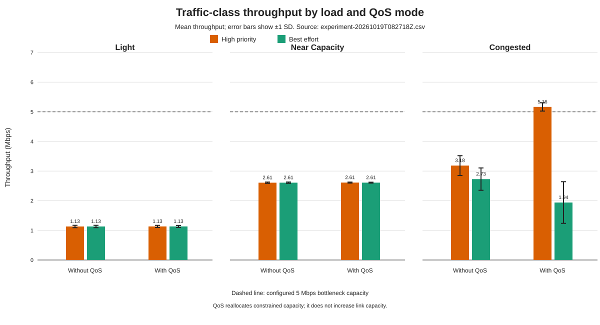

# Traffic Prioritization with Ryu and Mininet

TrafficPriority is an SDN testbed built with Ryu, OpenFlow 1.3, Open vSwitch, and Mininet. Two traffic sources share one 5 Mbps inter-switch bottleneck on their path to a receiver.

> **Current status:** the shared-bottleneck topology, contextual TCP/5001 and TCP/5002 classification, optional Open vSwitch HTB queue policy, repeatable A/B experiment runner, and traceable analysis workflow are implemented. One complete 18-run dataset and comparison plot are included.

See the [v1 baseline report](docs/baseline-v1.md) for the behavior before the topology correction and the [v2 release evidence](docs/release-v2.md) for the tested environment, MVP checklist, and claim boundaries.

## Topology

```text
h1 (10.0.0.1) --10 Mbps--\
                           s1 == 5 Mbps == s2 --10 Mbps-- h3 (10.0.0.3)
h2 (10.0.0.2) --10 Mbps--/                 \\--10 Mbps-- h4 (10.0.0.4)
```

`h1` and `h2` are the traffic sources, and `h3` is the primary receiver. Both source-to-receiver paths cross `s1-eth3 <-> s2-eth1`, the shared 5 Mbps bottleneck. The 10 Mbps access links are intentionally faster so they do not become the limiting path. Without QoS, Mininet's `TCLink` shapes the inter-switch link. With QoS, that link is created without a competing root qdisc and OVS's `linux-htb` policy enforces the same 5 Mbps egress limit on `s1-eth3`.

Both switches:

- use OpenFlow 1.3;
- run in secure fail mode; and
- must connect to the Ryu controller at `127.0.0.1:6653` before the CLI opens.

Startup does not run `pingAll()` or generate other test traffic. This leaves only the table-miss rules in place so first-packet behavior can be inspected deliberately.

### Packet path

```text
h1 or h2 application
  -> source access link
  -> s1 OpenFlow lookup
  -> Ryu PacketIn for a new directed flow
  -> TCP destination-port classification
  -> queue 1 (TCP/5001) or queue 0 (TCP/5002/fallback)
  -> s1-eth3, the 5 Mbps controlled egress
  -> s2 forwarding
  -> h3 receiver
```

OpenFlow rule priority decides which rule matches. The OVS HTB policy on `s1-eth3`, when enabled, performs the actual bandwidth allocation.

## Prerequisites

- Docker Desktop or Docker Engine with Linux containers
- A Linux or WSL2 environment capable of running privileged containers
- Kernel and container permissions sufficient for Open vSwitch and Mininet network namespaces

The published v2 evidence was captured with:

| Component | Tested version |
| --- | --- |
| Docker client/engine | `29.2.1` |
| Container kernel | `6.6.87.2-microsoft-standard-WSL2` |
| Python | `3.8.10` |
| Eventlet | `0.30.2` |
| Ryu | `4.34` |
| Mininet | `2.3.0.dev6` |
| Open vSwitch | `2.13.8` |
| iperf | `2.0.13` |

PyPI dependencies, including transitive packages, are pinned in [requirements.txt](requirements.txt). The Ubuntu 20.04 base image is pinned by digest, while `apt` packages resolve from the Ubuntu repositories available at build time. Other hosts and kernels may behave differently.

## Build and run

```bash
docker build -t traffic-priority .
docker run --privileged --rm -it traffic-priority
```

Enable the OVS queue policy explicitly for a QoS run:

```bash
docker run --privileged --rm -it -e QOS_ENABLED=1 traffic-priority
```

`run_all.sh` passes `--qos` to the topology when `QOS_ENABLED=1`, so the topology and controller always enter QoS mode together. The topology verifies that `s1-eth3` belongs to bridge `s1`, creates the policy after the switches connect, and removes it during shutdown.

On Linux or WSL2, the helper provides the shortest interactive quick start:

```bash
chmod +x start_project.sh
./start_project.sh
```

The container starts Ryu, creates the topology, waits for both switches to connect, prints the expected bottleneck ports, and opens the Mininet CLI.

The same helper can run the complete experiment and analyzer while mounting `results/` automatically:

```bash
./start_project.sh experiment
./start_project.sh analyze /app/results/raw/experiment-20261019T082718Z.csv
```

## Verify the topology

Before generating traffic, inspect the links, switch ports, controller state, and initial flows:

```text
mininet> links
mininet> sh ovs-ofctl -O OpenFlow13 show s1
mininet> sh ovs-ofctl -O OpenFlow13 show s2
mininet> sh ovs-ofctl -O OpenFlow13 dump-flows s1
mininet> sh ovs-ofctl -O OpenFlow13 dump-flows s2
```

The port inspection should show `s1-eth3` connected to `s2-eth1`. Before the first packet is sent, each flow table should contain only its priority-0 controller rule.

Verify both source-to-receiver paths and their reverse directions explicitly:

```text
mininet> h1 ping -c 1 h3
mininet> h2 ping -c 1 h3
mininet> h3 ping -c 1 h1
mininet> h3 ping -c 1 h2
```

In the default, queue-disabled mode, inspect the traffic-control class applied to the shared link:

```text
mininet> sh tc class show dev s1-eth3
```

It should report `rate 5Mbit ceil 5Mbit`. In QoS mode, use the inspection commands below instead. An indicative single-flow probe can then be run with:

```text
mininet> h3 iperf -s -p 5001 > /tmp/iperf-server.log 2>&1 &
mininet> h1 iperf -c 10.0.0.3 -p 5001 -t 5
```

Docker scheduling, short test duration, and Mininet resource-limit warnings can make a single `iperf` result noisy, so use the traffic-control state as the authoritative configured rate. This probe does not demonstrate QoS. A valid QoS experiment must run both traffic classes concurrently and compare queue-enabled and queue-disabled conditions.

## Verify traffic classification

The high-priority lab class is TCP/5001 and the best-effort lab class is TCP/5002. First generate ordinary ICMP traffic to prove learned forwarding does not hide later classification, then run both TCP flows:

```text
mininet> h1 ping -c 1 h3
mininet> h3 iperf -s -p 5001 > /tmp/iperf-server.log 2>&1 &
mininet> h3 iperf -s -p 5002 > /tmp/iperf-best-effort.log 2>&1 &
mininet> h1 iperf -c 10.0.0.3 -p 5001 -t 3
mininet> h2 iperf -c 10.0.0.3 -p 5002 -t 3
mininet> sh ovs-ofctl -O OpenFlow13 dump-flows s1
mininet> sh ovs-ofctl -O OpenFlow13 dump-flows s2
```

Ryu should log each classification once per switch. The flow dumps should contain priority-100 TCP/5001 and priority-90 TCP/5002 rules matching the ingress port, source and destination MAC addresses, source and destination IPv4 addresses, TCP source port, and TCP destination port. Without QoS, forward actions are `output:3` on `s1` and `output:2` on `s2`. With QoS, the `s1` actions are `set_queue:1,output:3` for TCP/5001 and `set_queue:0,output:3` for TCP/5002; `s2` still only uses `output:2`. A flood action is never stored as a class-specific rule.

The classification policy has non-privileged unit tests:

```bash
python -m unittest discover -s tests -v
```

### Fallback behavior

- ARP and non-TCP packets use learned forwarding with an EtherType- or IP-protocol-specific match.
- TCP ports without a configured class use a priority-10 contextual rule containing their directed IP and transport endpoints.
- An unknown destination is flooded for the current packet only. No flood output is installed in the flow table.
- LLDP is ignored by the application.
- MAC learning is isolated by datapath, so the same MAC can map to different ports on different switches.
- OpenFlow buffer ID `0` is treated as valid. The `OFP_NO_BUFFER` sentinel causes the packet bytes to be included in `PacketOut`.

## OVS queue policy

QoS mode installs one `linux-htb` policy on the verified bottleneck egress:

| Traffic | TCP destination | Queue | Minimum | Maximum |
| --- | --- | --- | --- | --- |
| High-priority lab class | `5001` | `1` | 3 Mbps | 5 Mbps |
| Best effort and fallback | `5002` or unclassified | `0` | 1 Mbps | 5 Mbps |

The parent port maximum is 5 Mbps. HTB permits unused capacity to be borrowed, so the minimums are allocation guarantees during contention, not fixed per-flow rates or strict-priority scheduling.

From the Mininet CLI, inspect the attachment, database records, realized kernel policy, OpenFlow actions, and counters with:

```text
mininet> sh ovs-vsctl get Port s1-eth3 qos
mininet> sh ovs-vsctl --columns=_uuid,type,other_config,queues,external_ids list QoS
mininet> sh ovs-vsctl --columns=_uuid,other_config,external_ids list Queue
mininet> sh ovs-appctl qos/show s1-eth3
mininet> sh tc -s class show dev s1-eth3
mininet> sh ovs-ofctl -O OpenFlow13 dump-flows s1
mininet> sh ovs-ofctl -O OpenFlow13 queue-stats s1
mininet> sh ovs-ofctl -O OpenFlow13 dump-ports s1 3
```

`ovs-appctl qos/show` and `queue-stats` should expose queue 0 and queue 1 packet/byte counters after traffic crosses the link. The setup and cleanup operations are safe to repeat:

```text
mininet> sh /app/scripts/cleanup_qos.sh s1-eth3
mininet> sh /app/scripts/setup_qos.sh s1-eth3 s1
```

Setup first removes any policy attached to that port, then creates exactly one owned QoS record and two owned Queue records. Cleanup clears the port reference and destroys those records; running cleanup again is a no-op.

## Automated A/B experiments

The experiment command recreates the same four-host/two-switch topology for the without-QoS and with-QoS scenarios. It restarts Ryu with the matching policy mode, starts both receiver servers automatically, and launches the TCP/5001 and TCP/5002 clients back-to-back so they run concurrently.

Each class offers the following paced load:

| Load level | Per class | Combined | Expected condition |
| --- | ---: | ---: | --- |
| `light` | 1 Mbps | 2 Mbps | Below capacity |
| `near_capacity` | 2.5 Mbps | 5 Mbps | At capacity |
| `congested` | 5 Mbps | 10 Mbps | Above capacity |

The default is three repetitions of every load in both scenarios, with 10-second client pairs. This produces 18 run IDs and 36 CSV rows because each run records both traffic classes.

Build the image, create a host results directory, and run the complete experiment. In Bash:

```bash
mkdir -p results/raw
docker build -t traffic-priority .
docker run --privileged --rm \
  --mount "type=bind,source=$PWD/results,target=/app/results" \
  traffic-priority experiment
```

In PowerShell:

```powershell
New-Item -ItemType Directory -Force results\raw
docker build -t traffic-priority .
docker run --privileged --rm `
  --mount "type=bind,source=$((Get-Location).Path)\results,target=/app/results" `
  traffic-priority experiment
```

For a quick integration check rather than a publishable experiment, override the duration and repetition count:

```bash
docker run --privileged --rm traffic-priority experiment \
  --duration 2 --repetitions 1 --output /tmp/smoke.csv
```

The generated CSV includes the experiment and run IDs, UTC timestamp, scenario, load, active policy, traffic class, protocol/port/queue, offered and measured throughput, configured duration, actual wall duration, client start skew, link capacity, egress rate/utilization, congestion detection, flow deltas, queue deltas when available, interface deltas, tool versions, and controller-log filename. Controller logs are written beside the CSV.

`congestion_detected=true` means the combined offered load exceeded 5 Mbps and the measured bottleneck egress reached at least 80% utilization. This supplies measured congestion evidence instead of inferring congestion from offered load alone. Without-QoS rows use flow and interface counters; with-QoS rows additionally record the corresponding queue counter delta.

Analyze any complete ticket 6 CSV using the same mounted results directory:

```bash
docker run --rm \
  --mount "type=bind,source=$PWD/results,target=/app/results" \
  traffic-priority analyze \
  /app/results/raw/experiment-20261019T082718Z.csv
```

The analyzer validates that every scenario/load/class condition is present and produces:

- `results/analysis/<experiment>/per-run.csv` with every paired run;
- `results/analysis/<experiment>/summary.csv` with mean, sample standard deviation, minimum, and maximum for each class, summed client throughput, and measured egress throughput;
- `results/analysis/<experiment>/analysis.md` with source hash, tables, conclusions, unexpected results, and limitations; and
- `results/plots/<experiment>-throughput-comparison.svg`, derived entirely from the saved raw CSV.

## Captured results



The included [analysis report](results/analysis/experiment-20261019T082718Z/analysis.md) covers 18 complete runs with three repetitions per condition. Its main observations are:

- Light and near-capacity class means were nearly identical between modes, so QoS made little measurable difference while bandwidth was not clearly scarce.
- Under the congested offered load, the high-priority client-side mean increased from 3.185 to 5.165 Mbps while the best-effort mean decreased from 2.729 to 1.939 Mbps. This indicates a class-allocation trade-off, not new capacity.
- Measured switch egress remained effectively fixed: 4.995 Mbps without QoS and 4.981 Mbps with QoS. Both are approximately 100% of the configured 5 Mbps bottleneck.
- Six congested runs had summed client-side TCP estimates above physical capacity. The report preserves this discrepancy and treats switch egress counters as authoritative for the capacity check; client figures can reflect buffering and measurement-boundary effects.

The [raw CSV](results/raw/experiment-20261019T082718Z.csv), controller logs, per-run summary, aggregate summary, report, and SVG are kept together so every claim can be traced back to recorded measurements.

## Cleanup

- Type `exit` or press Ctrl-D in the Mininet CLI. The topology removes its owned QoS and Queue records before stopping Mininet.
- The experiment runner tears down each network, controller, and QoS policy between scenarios and on handled failures.
- Containers use `--rm`, so Docker removes them after exit. If an interactive container is still running, locate it with `docker ps --filter ancestor=traffic-priority` and stop that exact container with `docker stop <container-id>`.
- If Mininet was run directly on Linux outside Docker and left stale interfaces, run `sudo mn -c` on that same host. This is normally unnecessary for the documented disposable-container workflow.
- Generated evidence is intentionally retained under `results/`; remove it only when you no longer need the audit trail.

## Repository structure

```text
.
|-- priority_ryu_controller.py   # Ryu learning/classification application
|-- ryu_topo.py                  # shared-bottleneck Mininet topology
|-- traffic_policy.py            # pure class/queue policy
|-- experiment_metrics.py        # pure runtime counter parsers
|-- result_analysis.py           # statistics, interpretation, SVG generation
|-- scripts/                     # QoS lifecycle, experiment, analysis, verification
|-- tests/                       # non-privileged unit tests
|-- docs/                        # baseline and release evidence
|-- results/raw/                 # measured CSV and controller logs
|-- results/analysis/            # per-run, aggregate, and narrative outputs
`-- results/plots/               # generated comparison SVG
```

## Package verification

Run the non-privileged release audit from the repository root:

```bash
python -B scripts/verify_package.py
```

It runs the unit suite, validates the full experiment matrix and repetition counts, requires congestion evidence for every high-load run, verifies all published artifacts, checks the raw CSV hash recorded in the report, parses the SVG as XML, and ensures all local work packages are resolved. The Docker build also runs the unit suite.

The source is licensed under the [MIT License](LICENSE). A release tag is deliberately left to the maintainer; the repository does not create or push tags automatically.

## Troubleshooting

### Docker or privilege errors

- `Operation not permitted`, namespace failures, or missing virtual interfaces usually mean the container was not started with `--privileged` or the host cannot provide Linux network namespaces.
- Use Linux containers. Windows containers cannot run this Mininet/OVS topology.
- On Windows, use Docker Desktop's WSL2 backend and confirm `docker info` reports `OSType: linux`.
- If Docker Desktop reports missing BuildKit snapshots or daemon connection errors, restart Docker Desktop and rerun the build. Do not delete project data to repair a Docker cache failure.

### OVS, Mininet, or controller errors

- If switches do not connect, check that nothing else is using TCP port `6653` and inspect the scenario controller log under `results/raw/`.
- `ovs-vsctl` database errors indicate the Open vSwitch service did not initialize; rerun in a fresh container and inspect its startup output.
- If QoS records exist but `ovs-appctl qos/show s1-eth3` has no queues, another qdisc may own the egress. Use the documented QoS mode, which leaves the inter-switch link available for OVS to own.
- Mininet's resource-limit warning is common inside Docker Desktop. Treat failed host creation or connectivity as an error, but record the warning when comparing environments.
- Ryu 4.34 is paired with Eventlet 0.30.2 and Python 3.8 in this image. Changing these versions can reintroduce import/runtime incompatibilities.

### Unexpected measurements

- Confirm the congested rows have `congestion_detected=true` and egress utilization near 100%; offered load alone is not evidence of congestion.
- Short runs are noisy. Use the default 10-second duration and three repetitions for conclusions.
- Client-side TCP totals may exceed egress because of buffering and measurement boundaries. Use switch egress counters for the physical-capacity check.
- QoS should make little difference below congestion. A lack of separation at light load is expected, not a failure.

## Current forwarding behavior

The Ryu application provides table-miss handling, per-datapath MAC learning, protocol-specific learned forwarding, explicit TCP/5001 and TCP/5002 classes, contextual fallback forwarding, and optional queue selection on the single configured bottleneck egress. Learned ARP, ICMP, or unrelated TCP rules cannot capture either classified traffic flow.

## Known limitations

- QoS is opt-in; the default run intentionally has no OVS QoS or Queue records.
- Flow rule priority is not packet scheduling priority; only the OVS HTB queues perform rate allocation.
- Python dependencies are pinned, but Ubuntu system packages can change if the upstream Ubuntu 20.04 repositories change.
- Privileged Mininet execution depends on the host kernel and Docker environment.
- Short smoke runs are useful for integration checks but are too noisy for conclusions; use the default duration and repetitions for collected results.
- Client-side TCP throughput can temporarily exceed measured egress because the measurement boundaries include buffering. Capacity conclusions use switch egress counters and retain both measurements for transparency.

## Release status

Every v2 MVP definition-of-done item is backed by code, tests, runtime counters, saved raw measurements, and generated analysis. TrafficPriority v2 is ready for a maintainer-created release tag on the tested platform. The evidence supports describing it as a controlled SDN QoS testbed, not as a production QoS system or a guarantee of application QoE.
